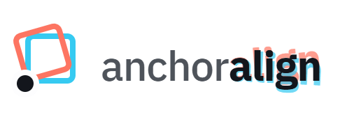
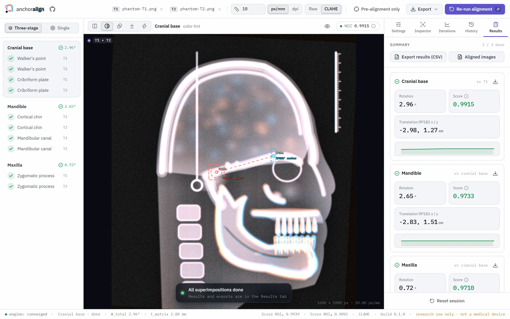

<p align="center">
  <picture>
    <source media="(prefers-color-scheme: dark)" srcset=".github/assets/logo-dark.png">
    
  </picture>
</p>

<p align="center">
  <b>Structural superimposition of lateral cephalograms in the browser.</b><br>
</p>

<p align="center">
  
  
  
  
</p>

<p align="center">
  <a href="https://anchoralign.org">Demo</a> ·
  <a href="#getting-started">Getting started</a> ·
  <a href="#how-it-works">How it works</a> ·
  <a href="#license">License</a>
</p>

<picture>
  <source media="(prefers-color-scheme: dark)" srcset=".github/assets/screenshot-dark.webp">
  
</picture>
<p align="center"><sub>Shown with a synthetic phantom image.</sub></p>

> [!IMPORTANT]
> **Research and education use only. Not a medical device.**
> anchoralign must not be used for diagnosis, treatment planning or any other
> clinical decision about patients. See [NOTICE.md](NOTICE.md).

## Why anchoralign

anchoralign aligns two lateral cephalograms of the same patient, for example
before and after treatment, so that growth and treatment changes become
visible. It follows the structural method in three standard superimpositions:
the cranial base, then the mandible and the maxilla on the cranial-base aligned
image. For each one you mark reference points on both images; anchoralign
pre-aligns the images and refines the superimposition automatically by matching
the image structures around those points.

<details>
<summary><b>All features</b></summary>

**Workflow**

- Three-stage mode: cranial base (Walker's point, cribriform plate), mandible
  (cortical chin, mandibular canal) and maxilla (zygomatic process, a single
  reference point)
- Mandible and maxilla results are relative to the cranial-base superimposition
- Standard settings per superimposition, adjustable for the session
- Each alignment starts automatically shortly after its last point, with time
  to correct a point first
- Single mode runs any one superimposition on its own

**Alignment**

- Landmark-based pre-alignment from the reference points of each image
- Refinement by normalized cross-correlation (NCC) on regions of interest
  around both reference points
- Two rotation strategies: a joint ring-segment search about RP1 (default), or
  rotation about the moving RP2
- Grayscale or combined grayscale + edge scoring, optional CLAHE contrast
  enhancement (raw scans by default)
- Option to keep the pre-alignment only, before or after refinement

**Comparison**

- Five comparison modes: side by side, color tint, opacity blend, difference
  and strobe (alternates T1 and the aligned T2)
- Landmarks and ROIs can be hidden for an unobstructed view

**Results and transparency**

- Summary of all superimpositions: rotation, RP1B2 translation, score curve and
  alignment score
- Per-ROI grayscale and edge NCC, residuals and displacement readings in mm
- Full iteration log with accepted and rejected steps, convergence status and
  a visual ROI history

**Calibration and export**

- Pixel scale read from image metadata (JPEG EXIF/JFIF, PNG `pHYs`, WebP EXIF)
  or entered in px/mm or dpi, with a warning when the two images disagree
- Export the aligned T2 of each superimposition as a PNG in T1's frame of
  reference, using the original pixels and keeping the pixel scale
- Export all results as CSV, including the settings used

**Interface**

- Light and dark theme; the image area stays dark for reading radiographs
- Explanations on hover, keyboard support throughout

</details>

## How it works

The first image is T1, the second T2. For each superimposition you mark
reference points RP1 and RP2 on both images; RP1B1 is RP1 on T1, RP1B2 is RP1
on T2, and so on.

| Superimposition | RP1 | RP2 |
|---|---|---|
| Cranial base | Walker's point | Cribriform plate |
| Mandible | Cortical chin | Mandibular canal |
| Maxilla | Zygomatic process | – |

1. **Place landmarks** on T1 and T2. The alignment starts 3 seconds after the
   last point, so you can still move a point before it runs.
2. **Pre-align.** T2 is rotated until its RP1→RP2 line is parallel to T1's,
   then shifted so RP1B2 lies on RP1B1. The maxilla has only one reference
   point, so it is only shifted.
3. **Refine.** Each cycle tries a small rotation and translation and keeps the
   step only if it raises the normalized cross-correlation (NCC) between
   regions of interest around the reference points by more than 0.0001. The
   loop stops when no step is accepted or the cycle limit is reached.
4. **Continue** with the mandible and the maxilla, which are superimposed on
   T2 as aligned on the cranial base. You can also run any single
   superimposition on its own.
5. **Compare and export** the aligned images and the results.

## Privacy

Your images never leave your browser. Radiographs are opened as local files
and processed entirely on your device: anchoralign has no backend, no upload,
no API and no tracking. The server only delivers the static app files, fonts
included, so the app makes no third-party requests. Display preferences
(theme, comparison mode, calibration unit, workflow mode) are stored in your
browser's `localStorage`; images, landmarks and results are not stored.

## Getting started

Requires Node.js 22.12 or newer. Built with TypeScript, React, Vite and
OpenCV.js, which runs as WebAssembly in a Web Worker.

```bash
npm install
npm run dev       # development server on http://localhost:5173
npm test          # run the test suite
npm run build     # type-check and build into dist/
```

<details>
<summary><b>Project structure</b></summary>

```text
src/
  App.tsx          page layout; wires the workspace state to the components
  components/      UI, one component per file, grouped by screen area
  hooks/           React state and effects; useWorkspace composes the others
  lib/             pure functions without React: stage definitions, the
                   workflow reducer, geometry, metadata, exports
  engine/          OpenCV worker and its typed client
  constants.ts     comparison modes, search limits, auto-start delay
  types.ts         shared types
```

Tests sit next to the code they cover (`*.test.ts`). Imports use the `@/`
alias for `src/`.

</details>

## Deployment

anchoralign is a static site. `npm run build` writes everything to `dist/`,
which any static web server can host; no backend is needed. If you set a
Content Security Policy, it must allow `'unsafe-eval'` and
`'wasm-unsafe-eval'` for scripts: the OpenCV.js runtime is evaluated in the
worker and compiles WebAssembly.

## Tech stack

TypeScript 7 · React 19 · Vite 8 · OpenCV.js 5.0 (WebAssembly, in a Web
Worker) · Canvas 2D / OffscreenCanvas · Vitest 5

## License

anchoralign is source-available under the
[PolyForm Noncommercial License 1.0.0](LICENSE.md). It is free to use, modify
and share for personal use, research, education and by noncommercial
organizations.

Commercial use, including integration into commercial products, requires a
separate license. Contact [licensing@noxenum.io](mailto:licensing@noxenum.io).

Third-party components and their licenses are listed in [NOTICE.md](NOTICE.md).

## Contributing

Bug reports and suggestions are welcome via GitHub Issues. We do not accept
external pull requests at the moment; see [CONTRIBUTING.md](CONTRIBUTING.md).
Please never attach patient images or other health data to issues.

## Credits

Developed by [Noxenum GmbH](https://noxenum.io) in collaboration with
Dr. med. dent. Jan Danz.
